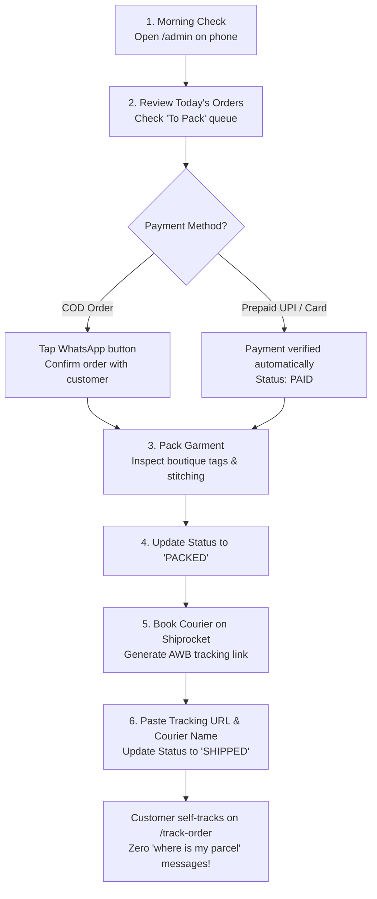

# Royal Libas by Tanya — Boutique Owner Handover Guide
**Congratulations Tanya!** Your online store is officially built, tested, hardened, and ready for soft launch.

> [!WARNING]
> **SAMPLE ONLY — all 16 products are placeholders made by tinting/cropping 3 base images, to be replaced with Tanya's real photos, prices and stock before launch.**

This document is your plain-English daily operating manual. You do not need any coding knowledge to manage your catalogue, fulfill orders, or serve your customers.

---

## 1. Quick Access Links

| Page | Public URL | Purpose |
|---|---|---|
| **Online Store** | `https://yourdomain.com/` | Customer storefront and home page |
| **All Collections** | `https://yourdomain.com/shop` | Searchable product catalogue with size & price filters |
| **Admin Panel** | `https://yourdomain.com/admin` | Your mobile-friendly boutique command center |
| **Order Tracking** | `https://yourdomain.com/track-order` | Customer self-serve shipment tracking |
| **WhatsApp Support** | To be confirmed by Tanya | Direct customer concierge |

> [!IMPORTANT]
> **Admin Login Security:**  
> Access `/admin` directly on your smartphone (Safari or Chrome). Use your registered admin email and password.  
> *Security rule:* Do not share your login credentials in public WhatsApp groups or social media screenshots. If you enter an incorrect password 5 times in a row, the admin panel locks automatically for 5 minutes to prevent unauthorized access.

---

## 2. Tanya's Daily 15-Minute Boutique Routine

You can manage all daily fulfillment in 15 minutes straight from your mobile phone:



### Step-by-Step Instructions:

1. **Check New Orders:**  
   Open `/admin` on your mobile browser. The top dashboard highlights:
   - **Today's Orders** and **Today's Revenue**.
   - **To Pack Queue**: Number of placed orders waiting to be packed.
   - **Low Stock Alerts**: Any designs with 5 or fewer pieces remaining.

2. **Confirm COD Orders on WhatsApp:**  
   Next to every order is a green **WhatsApp** button.  
   For COD orders, tap this button to open a pre-filled WhatsApp message confirming the delivery address and dress size before you dispatch:
   > *"Hello [Customer Name]! Thank you for ordering the [Dress Name] (Size [M]) from Royal Libas. We are preparing your order for dispatch to [City]. Please reply YES to confirm your cash-on-delivery order."*

3. **Pack & Mark as 'Packed':**  
   Fold the garment with boutique butter paper and verify the size tag. In the order details in `/admin`, change the dropdown from `PLACED` to `PACKED`.

4. **Book Courier & Paste Tracking Link:**  
   Book your courier on Shiprocket or Delhivery. Copy the public tracking link.  
   In `/admin`, enter the courier name (e.g. `Delhivery`, `Blue Dart`, `DTDC`) and paste the tracking link into the **Tracking Link** field.  
   Change status to `SHIPPED` and tap **Update Status**.

5. **Customer Live Tracking:**  
   The customer can check `/track-order` anytime using their **Order Code** (`RL-2026-XXXX`) and **10-digit phone number**. They see a live progress bar and a direct button to track on the courier's site.

---

## 3. Managing Catalogue & Inventory

### How to Change Stock in 1 Second:
- Go to `/admin/products` on your phone.
- Find the product. Every size (XS, S, M, L, XL, XXL) has quick **`+`** and **`-`** buttons.
- Tap `+` to add a piece, or `-` when you sell a piece offline in your Jaipur studio. Stock updates on the live website immediately.
- If a size reaches `0`, it is automatically marked as **Sold Out** with a strike-through on the product page. Customers cannot order it.

### How to Put an Item on Sale:
- In `/admin/products`, tap **Edit** on any item.
- Keep the **MRP** high (e.g. ₹3,999) and lower the **Selling Price** (e.g. ₹2,999).
- The store automatically calculates the discount and displays a gold **25% OFF** pill on the photo!

### How to Add a New Design:
1. Tap **+ Add Product** in `/admin/products`.
2. Enter the design name (e.g., *Gulabi Rooh Anarkali Set*).
3. Choose the collection: `Festive Edit`, `Everyday Cotton`, or `Kurti Sets`.
4. Enter fabric (e.g., *Pure Chanderi Silk with Cotton Lining*) and care instructions (e.g., *Dry Clean Only*).
5. Add your sizes and initial inventory counts.
6. Upload 4 photos:
   - Front view (well-lit, straight angle)
   - Back view
   - Close-up detail of embroidery / neckline work
   - Model worn look
7. Tap **Save Product**. It appears in the shop instantly!

---

## 4. How to Handle Size Exchanges (7-Day Guarantee)

Your policy is: **"Hassle-free size exchange within 7 days of delivery, tags intact."**

When a customer messages asking for a different size:
1. Ask for their Order Code (`RL-2026-XXXX`) or phone number.
2. Search the code in `/admin/orders` to verify purchase date and original size.
3. Check `/admin/products` to see if the replacement size is available in stock.
4. If available:
   - Tell the customer: *"We have reserved Size L for you! Our courier will pick up Size M and deliver Size L to your doorstep."*
   - Book a reverse pickup on your Shiprocket dashboard.
5. If the size is sold out:
   - Offer an exchange for another design of equal value, or store credit for the next drop.

---

## 5. What is a Bug vs. a New Feature?

To keep your shop running smoothly without unexpected costs, here is how we handle requests:

| Type | Examples | What to do |
|---|---|---|
| **Bug** *(Fixed under launch warranty)* | • Checkout button stuck or shows an error<br/>• Customer paid online but order didn't generate<br/>• Tracking search fails for a valid order | Take a screenshot, copy the order code (`RL-2026-XXXX`), and message the developer immediately. |
| **Boutique Content** *(Tanya can do directly in Admin)* | • Updating product photos<br/>• Changing price or stock count<br/>• Adding a new Festive collection | Follow Section 3 above in `/admin`. No developer needed! |
| **New Feature** *(Post-Launch Backlog)* | • Customer login accounts & password reset<br/>• Automatic Shiprocket API courier booking<br/>• GoKwik 1-click checkout<br/>• Customer reviews and star ratings | Kept on the Post-Launch Backlog (Appendix C of website plan). Quoted and built as a separate phase when sales reach 100+ orders/month. |

---

## 6. Who Pays What After Launch?

All third-party service costs are paid directly by the Royal Libas business with zero developer markup:

| Service | Purpose | Estimated Cost | Billing Frequency |
|---|---|---|---|
| **Custom Domain** (e.g. GoDaddy / Namecheap) | `royallibas.com` address | ~₹800 – ₹1,200 / year | Annual renewal |
| **Backend Hosting** (Render / Railway) | Keeps API and database warm 24/7 | ~₹450 – ₹600 / month ($5–$7) | Monthly direct card |
| **Cashfree Payment Gateway** | UPI, Credit/Debit cards, Netbanking | As per the Cashfree dashboard at go-live | Deducted automatically per sale |
| **Courier (Shiprocket / Delhivery)** | Pan-India door-to-door delivery | ~₹60 – ₹110 per shipment (weight-based) | Prepaid courier wallet |

---

## 7. Launch Day Runbook (5 November)

Follow this schedule for your soft launch:

```
[09:00 AM] MORNING TEST ORDER
   • Open your phone browser and visit your store.
   • Pick a set, add Size M to bag, checkout with COD.
   • Verify Order Confirmation screen appears.
   • Open /admin on your phone, see the order, mark as PACKED, then test SHIPPED.

[12:00 PM] PUT LINK IN INSTAGRAM BIO
   • Update Instagram bio link to: https://royallibas.com
   • Post 1 launch Reel / Story showcasing the Festive Edit.
   • Pin a comment: "Festive Collection now live on our website! Tap the link in bio. 
     ✓ Pan-India Delivery ✓ 7-Day Size Exchange ✓ Cash on Delivery Available"

[02:00 PM – 06:00 PM] AFTERNOON CONCIERGE
   • Watch WhatsApp for size questions (help customers pick between M and L).
   • For every COD order, tap the WhatsApp button in /admin to confirm address.

[08:00 PM] EVENING FULFILLMENT
   • Count today's orders in /admin.
   • Pack the garments with care.
   • Note any customer feedback in a notepad — this becomes our post-launch polish list!
```

---

## 8. Definition of Done for the Entire Project

The project is considered 100% complete and delivered when:
> **A stranger on Instagram can discover Royal Libas, click the bio link, select an in-stock garment and size, pay via UPI or choose Cash on Delivery, receive a clean order confirmation, and self-track their delivery — while Tanya can manage the entire fulfillment, stock counts, and customer service straight from her phone without needing developer assistance.**

Everything is now tested, verified, and ready. Wishing **Royal Libas by Tanya** huge success on launch day! 🌸👗
